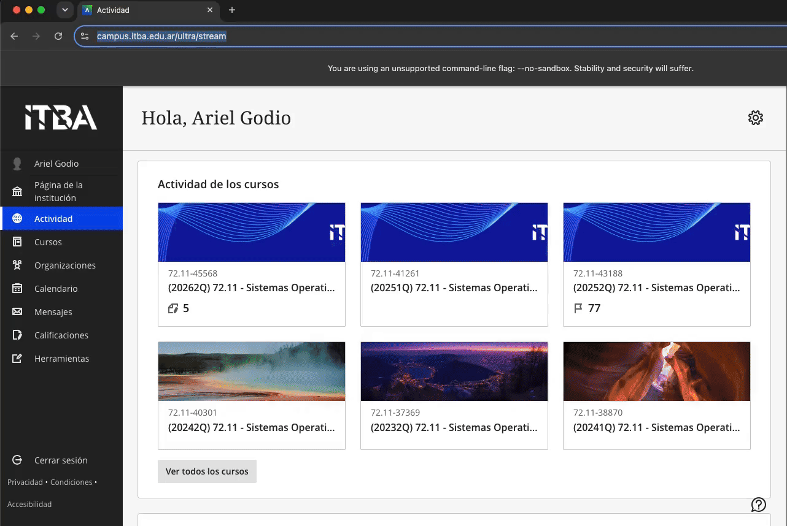

# Blackboard Grading and File Upload

A Python script that automates grade updates and individual feedback file uploads in Blackboard using Playwright.

Blackboard allows grades to be uploaded in bulk from a spreadsheet, but does not provide a built-in way to attach different feedback files to multiple students at once. This script automates both operations by processing a list of student IDs, grades, and file paths.

## Dependencies

- Python 3
- [Google Chrome](https://www.google.com/chrome/)
- [Playwright](https://playwright.dev/python/)

## Setup

```bash
python3 -m venv env
source env/bin/activate
pip install playwright
```

## Input File

The input file must contain one entry per line, with the following format:

```text
student_id grade file_path
```

For example:

```text
12345 8.5 Feedback/12345.pdf
12346 9.0 Feedback/12346.pdf
12347 7.0 Feedback/12347.pdf
```

Lines starting with `#` and empty lines are ignored. File paths can be absolute or relative to the current working directory.

An example input file is provided in `Data/lista-legajos-notas-rutas.txt`.

## Usage

With the virtual environment activated, run:

```bash
python gradeAndUpload.py "Assignment Name" Data/lista-legajos-notas-rutas.txt
```

Example Output
```
Alumnos a procesar: 3

Iniciar sesión y navegar hasta el libro de calificaciones del curso correspondiente

Procesando legajo 12345 (nota: 10)
Adjunto cargado para 12345: examen.pdf

Procesando legajo 23456 (nota: 9,5)
Adjunto cargado para 23456: examen-2.txt

Procesando legajo 34567 (nota: 8,5)
Adjunto cargado para 34567: examen-3.txt
```



Replace `Assignment Name` with the exact name of the Blackboard gradebook activity.

The script will:

1. Open Blackboard in Google Chrome.
2. Wait for you to log in and navigate to the appropriate course gradebook.
3. Filter the gradebook by the specified activity.
4. For each student:
   - Search for the student by ID.
   - Update their grade.
   - Attach the corresponding file to their overall feedback.

The script uses a persistent browser profile (`blackboard_profile`) to retain the login session between executions.

