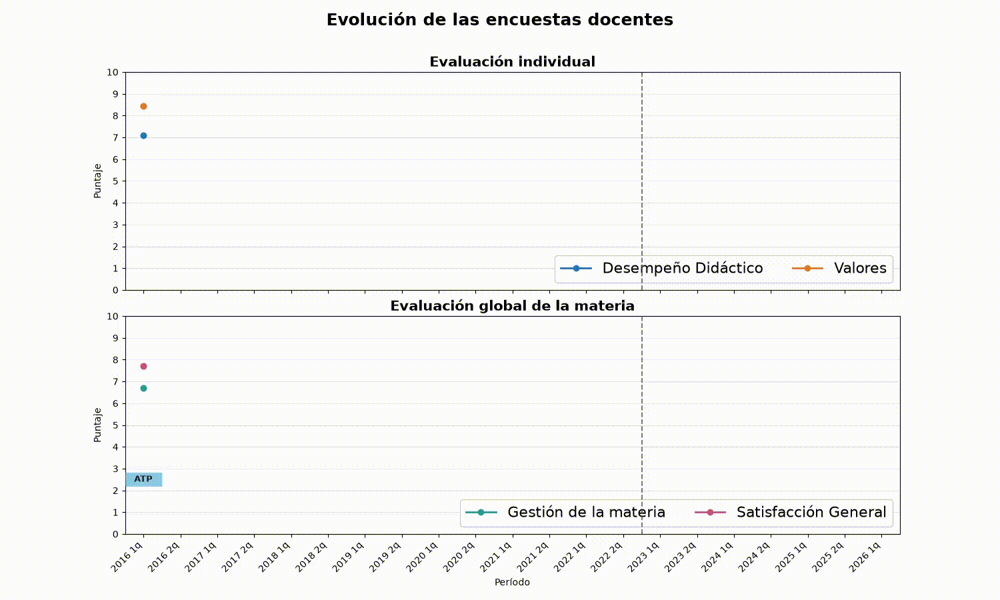

# Teaching Survey Visualization

A Python script that generates a video showing the evolution of teaching evaluation results over time, using the data stored in `datos.csv`.



## Dependencies

- Python 3
- [FFmpeg](https://ffmpeg.org/)

## Setup

```bash
python3 -m venv env
source env/bin/activate
pip install -r requirements.txt
```

Make sure `ffmpeg` is installed and available in your `PATH`.

## Usage

With the virtual environment activated, run:

```bash
python3 animar.py
```
